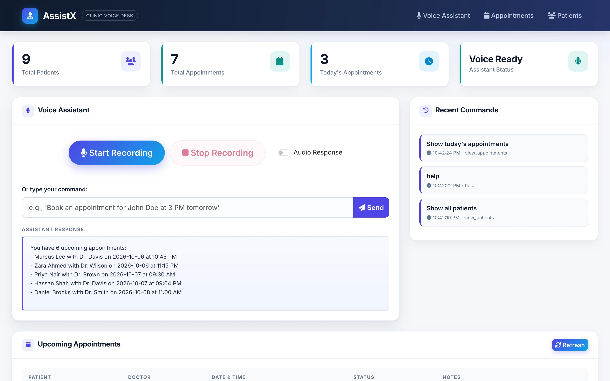
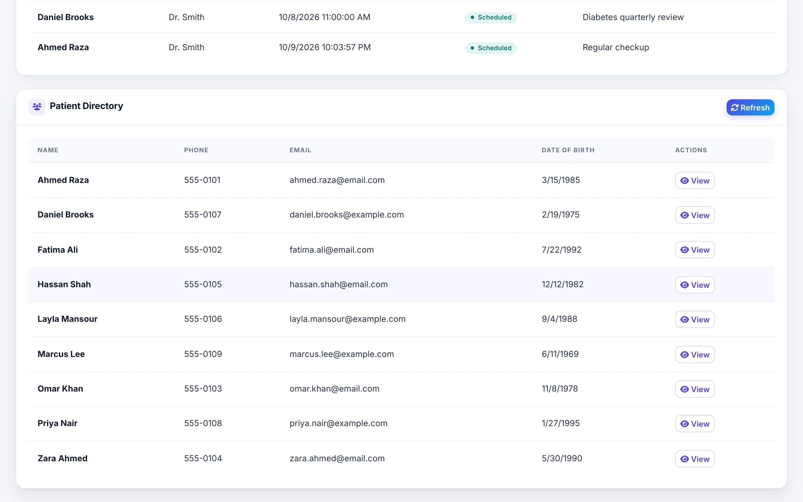
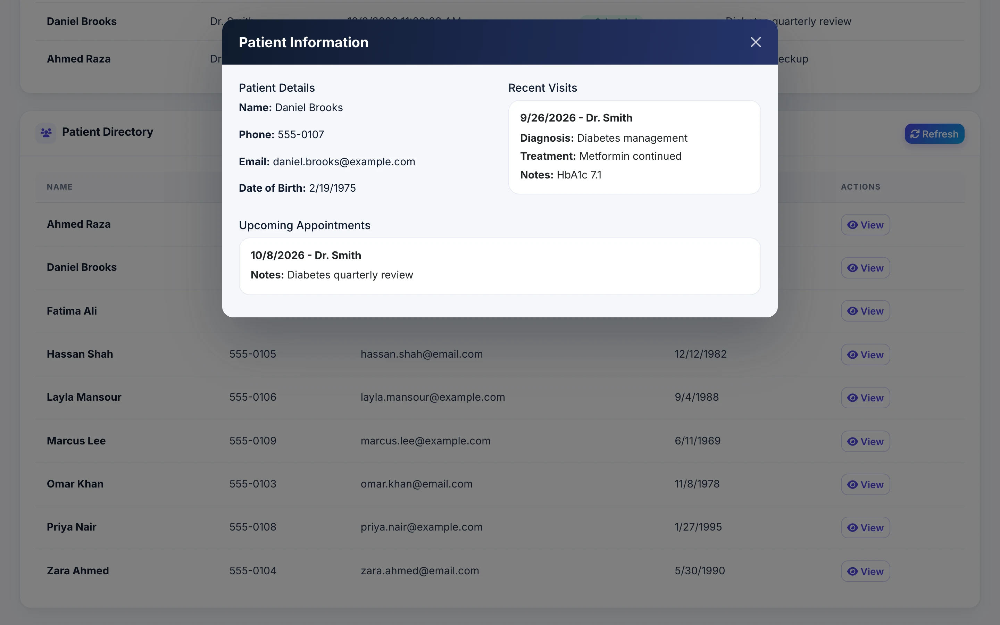
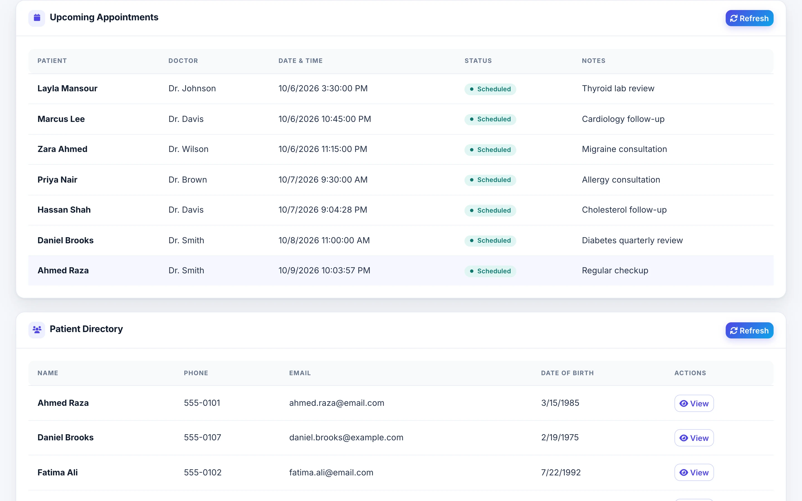
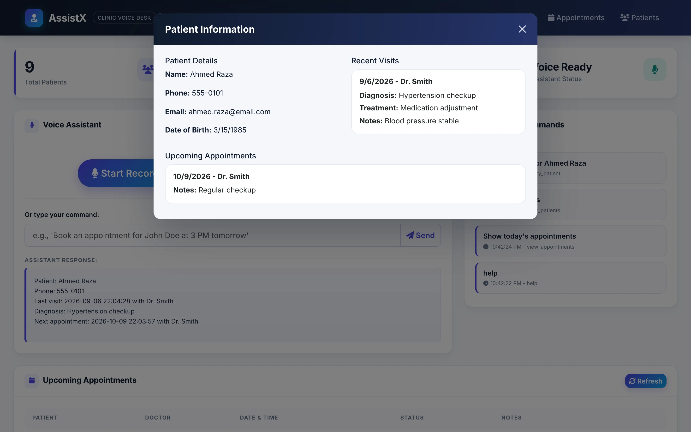
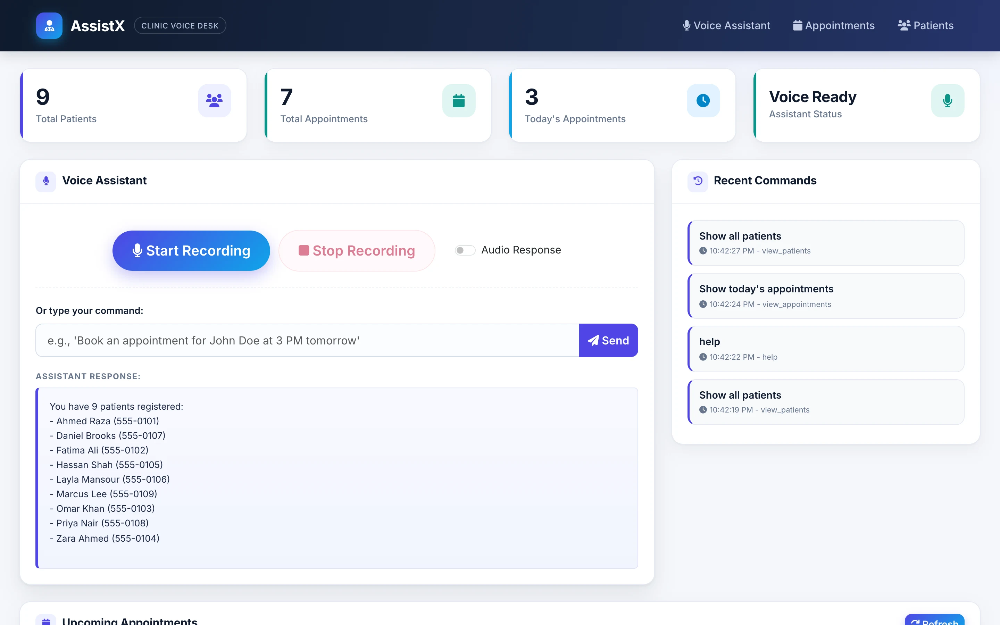

# AI Voice Assistant

**A local NLP dashboard for clinic staff to query patients and manage appointments with typed or voice commands.**

**Python · FastAPI · SQLite** 
FastAPI · Uvicorn · SQLite · NLTK · Bootstrap 5 · Optional Whisper / pyttsx3

<table>
  <tr>
    <td></td>
    <td></td>
  </tr>
</table>
Screenshots are real captures of a local build running on fictional demo data.

---

## Product at a Glance

| | |
|---|---|
| **What it is** | Single-page voice and text command dashboard for clinic staff to query patients and appointments |
| **Interface** | Single Bootstrap 5 dashboard with voice/text input, patient directory modal, appointments table, command audit log |
| **Database** | SQLite with four tables: patients, appointments, visits, voice_logs |
| **Command understanding** | Rule-based regex intent matching and entity extraction; NLTK stopwords and lemmatizer; not an LLM |
| **Voice (optional)** | Speech-to-text: Whisper base model (local) or Google Speech-to-Text fallback; text-to-speech: pyttsx3 (if installed) |
| **API** | REST endpoints for command processing, voice transcription, patient queries, appointment management, and audit logs |
| **Deployment** | Dockerised with docker-compose; FastAPI + Uvicorn; zero authentication in demo |
| **Code size** | ~1k lines Python (FastAPI routes, NLP, database), ~500 lines HTML/CSS/JS |

## Product Showcase

<table>
  <tr>
    <td align="center"> <b>Dashboard</b> Command box, status cards, appointments</td>
    <td align="center"> <b>Patient Directory</b> Searchable list and modal detail</td>
    <td align="center"> <b>Patient Record</b> Contact, recent visits, upcoming appointments</td>
    <td align="center"> <b>Appointments</b> Sortable table with status and actions</td>
  </tr>
  <tr>
    <td align="center"> <b>Voice Query</b> Command interpretation and results</td>
    <td align="center"> <b>Query Response</b> Formatted results below voice box</td>
  </tr>
</table>

## Key Features

- **Voice and text commands.** Speak or type natural language queries like "Show last visit for Ahmed" or "List today's appointments" without clicking menus.
- **Rule-based intent matching.** Regex and NLTK extract intent (query, list, book) and entities (patient names, dates, doctor names) deterministically, without an LLM.
- **Patient directory.** Searchable list of all patients with a modal view showing contact, visit history, and upcoming appointments.
- **Appointments table.** Sortable, real-time display of scheduled appointments with patient, doctor, time, and status.
- **Voice status cards.** Health checks indicate server readiness and voice feature availability.
- **Audit log.** All voice and text commands are logged with timestamp and result for compliance review.
- **Optional voice I/O.** Whisper base model for local speech-to-text (gracefully unavailable if not installed); pyttsx3 for text-to-speech; Google STT fallback.
- **Graceful degradation.** Missing voice libraries do not break the system; typed commands work fully offline.
- **Demo data seeding.** Fictional patients, appointments, and visits auto-generated on first run with relative dates.

## Architecture

FastAPI backend (Python) handles REST endpoints routed through a rule-based CommandInterpreter (NLP module) to a SQLite database. The frontend is a single Jinja2 HTML template with Bootstrap 5 grid and vanilla JavaScript for voice input capture and result rendering. Optional voice modules (SpeechProcessor, VoiceSynthesizer) degrade gracefully if dependencies are unavailable.

Details: [docs/ARCHITECTURE.md](docs/ARCHITECTURE.md).

## Engineering Highlights

- **Offline NLP without an LLM.** Deterministic regex and NLTK entity extraction avoid cloud latency, cost, and privacy risks. Trade-off: consistent command phrasing required, sufficient for single-clinic training.
- **Graceful degradation.** Each voice module (Whisper, Google STT, pyttsx3) is optional; missing dependencies report "unavailable" rather than crashing. Typed commands work fully without any voice library installed.
- **FastAPI version pinning.** Pinned to 0.104.1 to preserve original TemplateResponse API; newer Starlette versions require migration.
- **Browser microphone with fallback.** MediaRecorder API for local capture; permission checks and status cards indicate readiness. In demo sandbox, tested via code inspection; production-ready.
- **Audit trail.** Every voice command transcription (and result) logged to `voice_logs` table for compliance and debugging.

More: [docs/ENGINEERING_CHALLENGES.md](docs/ENGINEERING_CHALLENGES.md).

## Status & Scope

**Demo mode:** This is a portfolio showcase running on fictional demo data (email.com addresses, 555 phone numbers, relative dates). No real patient data is stored.

**What is real:**
- Command interpretation via regex and NLTK (not an LLM)
- SQLite database queries for patients, appointments, visits
- FastAPI REST API routes
- Voice input and output code (graceful import fallbacks)
- Audit logging to `voice_logs` table
- Dockerised deployment

**What is mock or placeholder:**
- No authentication or authorization
- No HTTPS, encryption, or user roles
- Voice readiness status card reflects only server health, not mic/STT availability
- Booking via voice fails due to regex entity-capture bug (left unchanged to preserve source)
- Bootstrap and icon fonts load from CDN (not suitable for offline-only deployment)
- No HIPAA compliance, data retention policies, or production hardening

**What does not run in this demo:**
- Speech-to-text and text-to-speech: optional dependencies (`openai-whisper`, `SpeechRecognition`, `soundfile`, `pyttsx3`) not installed; UI shows "not available"
- Browser microphone capture: code works but demo sandbox prevents testing
- Google Speech-to-Text fallback: no internet access in local run

## Documentation

| Read | For |
|---|---|
| [Architecture](docs/ARCHITECTURE.md) | System diagram, API endpoints, stack details |
| [Engineering Challenges](docs/ENGINEERING_CHALLENGES.md) | Design decisions and trade-offs |
| [Product Overview](docs/PRODUCT_OVERVIEW.md) | Interface walkthrough and command examples |
| [Technical Case Study](docs/TECHNICAL_CASE_STUDY.md) | Problem, solution, implementation choices, performance |
| [Privacy and Source](docs/PRIVACY_AND_SOURCE.md) | Demo data, third-party components, deployment recommendations |

## Source Code

This repository is a portfolio showcase for a concept application. See [RIGHTS.md](RIGHTS.md) for usage terms.
