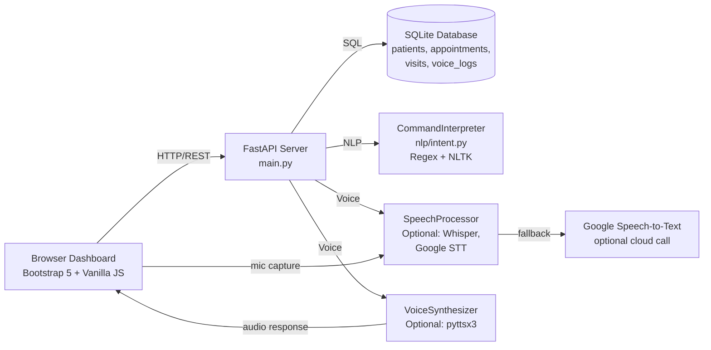

# Architecture

AssistX is a FastAPI web application backed by SQLite. The browser dashboard communicates with REST API endpoints; the backend routes requests through an NLP command interpreter to the database, with optional voice I/O.

## System diagram

## Stack

- **Backend:** Python 3.9+, FastAPI 0.104.1, Uvicorn ASGI server, Pydantic for validation.
- **Frontend:** Single-page HTML + Jinja2, Bootstrap 5 CSS, vanilla JavaScript with MediaRecorder API for mic capture.
- **Database:** SQLite with async wrappers; four tables (patients, appointments, visits, voice_logs).
- **NLP:** Rule-based regex intent matching and entity extraction. NLTK for stopwords and lemmatizer utilities (not trained models).
- **Voice (optional):** OpenAI Whisper "base" model for speech-to-text (requires `openai-whisper`); pyttsx3 for text-to-speech. Google Speech-to-Text as STT fallback. None are required; the system gracefully degrades if missing.

## API endpoints

| Endpoint | Method | Purpose |
|----------|--------|---------|
| `/` | GET | Dashboard HTML page |
| `/api/health` | GET | Server readiness check |
| `/api/voice/process-command` | POST | Interpret text command and return results |
| `/api/voice/transcribe` | POST | Convert audio bytes to text (Whisper or Google) |
| `/api/appointments` | GET | List all appointments |
| `/api/appointments/create` | POST | Create a new appointment |
| `/api/patients` | GET | List all patients or search by name |
| `/api/patients/query` | POST | Query patient details (e.g. last visit) |
| `/api/logs` | GET | Retrieve command audit log |

## Startup and data

On first run, `main.py` calls `populate_demo_data()` to create schema and seed fictional patients, appointments, and visits. The DB file is persisted in `database/assistx.db`.

## Graceful degradation

If voice libraries are not installed, the UI still functions for typed commands. Missing speech-to-text reports "not available"; missing text-to-speech silently skips audio.

Continue with the [technical case study](TECHNICAL_CASE_STUDY.md).
